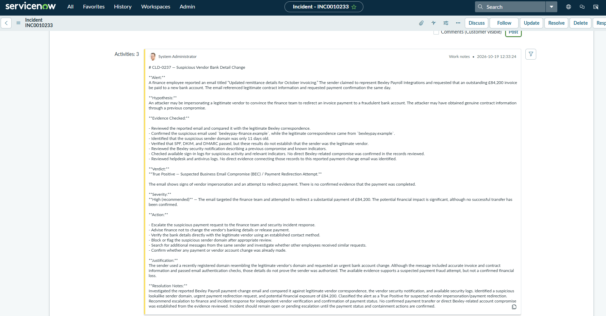

# ServiceNow SOC Incident Investigation

## Project Overview

This project documents my hands-on SOC analyst investigation in a simulated ServiceNow environment. I investigated a suspicious vendor bank account change request, reviewed email and security evidence, assessed the potential financial impact, and documented my findings in a ServiceNow incident ticket.

**Incident:** CLD-0237 — Suspicious Vendor Bank Detail Change  
**Platform:** ServiceNow (SOC Simulation)  
**Classification:** True Positive — Suspected Business Email Compromise (BEC)  
**Recommended Severity:** High  
**Potential Financial Exposure:** £84,200

## Alert

A finance employee reported an email titled "Updated remittance details for October invoicing." The sender claimed to represent Bexley Payroll Integrations and requested that an outstanding £84,200 invoice be paid to a new bank account.

## Hypothesis

An attacker may be impersonating a legitimate vendor to redirect a payment to a fraudulent account. The attacker may have obtained genuine contract information through a previous compromise.

## Evidence Checked

- Compared the reported email against legitimate vendor correspondence.
- Identified a lookalike sender domain, `bexleypay-finance.example`, instead of `bexleypay.example`.
- Identified that the suspicious domain was only 11 days old.
- Reviewed SPF, DKIM, and DMARC authentication results, which passed but did not establish vendor legitimacy.
- Reviewed the vendor's security notification and available sign-in, helpdesk, and antivirus records.
- Found no confirmed payment transfer or direct account compromise in the reviewed evidence.

## Verdict and Severity

**True Positive — Suspected Business Email Compromise / Payment Redirection Attempt.**

**High severity recommended** because the request targeted a substantial payment. No completed fraudulent transfer was confirmed.

## Recommended Actions

- Escalate the suspicious request to finance and incident response.
- Advise finance not to change payment details until verified.
- Independently confirm bank details with the legitimate vendor.
- Review and potentially block the suspicious sender domain.
- Search for additional related messages and determine whether any payment was made.

## Resolution Notes

Documented the investigation in ServiceNow and recommended escalation, independent vendor verification, and confirmation of payment status. The incident should remain open or pending escalation until containment and payment verification are completed.

## Investigation Evidence

## Skills Demonstrated

ServiceNow | SOC Alert Triage | Phishing Analysis | Business Email Compromise | Email Header Analysis | Incident Documentation | Security Log Review

*This project was completed in a simulated SOC training environment.*
